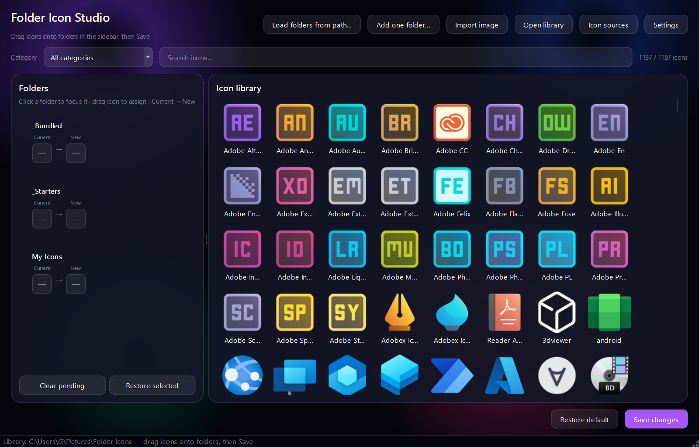
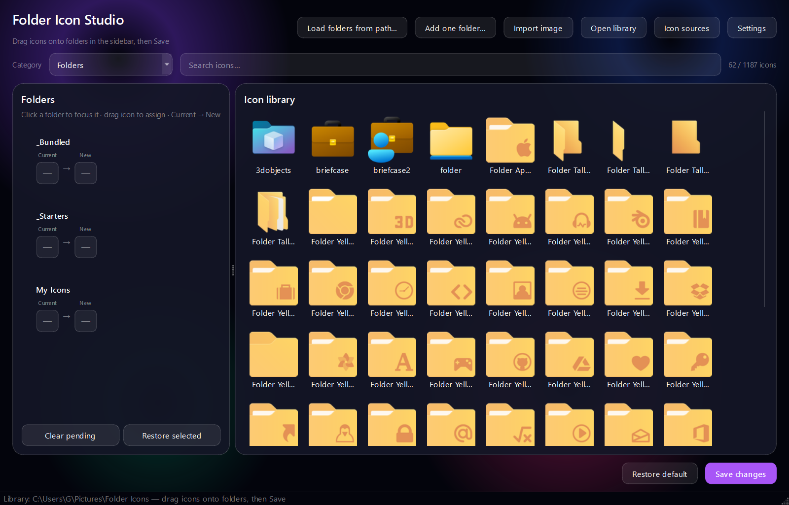
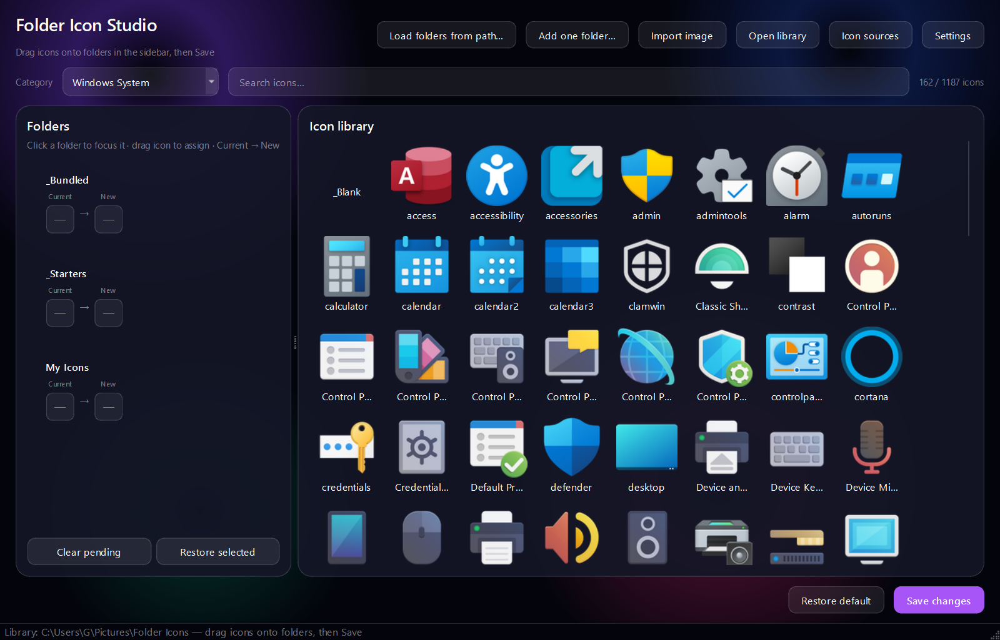
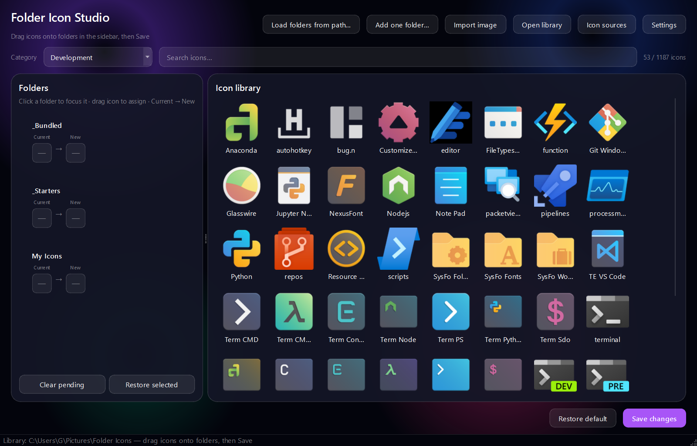

# Folder Icon Studio

A modern Windows desktop app to **change folder icons** with drag-and-drop, 800+ built-in icons, and a glassmorphic dark UI.



## Download (recommended)

**No Python. No build steps. Just run.**

1. Open **[Releases](https://github.com/Karthus3560/folder-icon-studio/releases/latest)**
2. Download **`FolderIconStudio.exe`** (or the `.zip` if you prefer)
3. Double-click **`FolderIconStudio.exe`** to launch

> **Windows SmartScreen:** The app is not code-signed yet. If Windows shows a warning, click **More info → Run anyway**. The executable is built from the open-source code in this repository.

### Optional: install shortcuts

If you want Desktop + Start Menu shortcuts (still no admin required):

```powershell
# After downloading/extracting the repo or release files:
.\install.ps1
```

This copies the app to `%LOCALAPPDATA%\FolderIconStudio` and creates shortcuts.

---

## Screenshots

| Main workspace | Folder icons library |
|---|---|
|  |  |

| Windows system icons | Development tools |
|---|---|
|  |  |

---

## Features

- **Drag-and-drop** — assign icons by dragging from the grid onto a folder in the sidebar
- **Live preview** — see **Current → New** icon for each folder before saving
- **800+ bundled icons** in 20 smart categories (Folders, Office, Adobe, Development, System, …)
- **Import your own** PNG/JPG/ICO images
- **Category filter + search** for large libraries
- **Glassmorphic UI** — dark theme with violet accents
- **Portable** — single `.exe`, no installer required

---

## How to use (step by step)

### 1. Launch the app

Run `FolderIconStudio.exe`. On first launch, icons are copied to:

`%USERPROFILE%\Pictures\Folder Icons\`

### 2. Load folders

- **Load folders from path…** — pick a parent directory; all subfolders are listed in the left sidebar  
- **Add one folder…** — add a single folder

### 3. Pick icons

- Browse the icon grid on the right  
- Use the **category** dropdown (e.g. *Folders*, *Microsoft Office*, *Development*)  
- Use **Search icons…** to filter by name

### 4. Assign icons

**Drag** an icon from the grid **onto** a folder row in the sidebar.

The row shows:

- **Current** — icon Windows is using now  
- **New** — icon you picked (not saved yet)

Click a folder row to focus it. Use **Clear pending** or **Restore selected** to undo before saving.

### 5. Save

Click **Save changes** to apply all pending assignments. Explorer updates immediately.

### 6. Import custom icons

- **Import image** — adds PNG/JPG/ICO to `My Icons\`  
- Or copy `.ico` files into your library folder manually

**Open library** opens the icon folder in Explorer.

---

## Icon library layout

```
%USERPROFILE%\Pictures\Folder Icons\
  _Bundled\          ← 800+ categorized icons (auto-seeded)
  _Starters\         ← 26 colored folder icons
  My Icons\          ← your imports
```

### Categories (examples)

| Category | What's inside |
|----------|----------------|
| Folders | Yellow/tall/themed folder icons |
| Windows System | Settings, Control Panel, Task Manager, Trash |
| Microsoft Office | Word, Excel, Teams, Outlook |
| Adobe Creative | Photoshop, Illustrator, Premiere |
| Development | VS Code, terminals, Python, Git |
| Music & Video | Spotify, VLC, Netflix |
| Web Browsers | Edge, Chrome, Firefox |
| … | 20 categories total |

---

## Restore default icons

- **Restore selected** — remove custom icon from the focused folder  
- **Restore all** — reset every loaded folder to the Windows default

---

## Build from source

Requires **Windows**, **Python 3.10+**.

```powershell
git clone https://github.com/Karthus3560/folder-icon-studio.git
cd folder-icon-studio
pip install -r requirements.txt
.\build.ps1
```

Output: `publish\FolderIconStudio.exe`

Place your source icons in `New Icons\` (optional — bundled icons are already in `folder_icon_studio/assets/bundled/`).

---

## How it works

Windows stores custom folder icons in a hidden `desktop.ini`:

```ini
[.ShellClassInfo]
IconResource=C:\full\path\to\icon.ico,0
```

The folder gets **System + Read-only** attributes; `desktop.ini` is hidden and UTF-16. The app calls `SHChangeNotify` so Explorer refreshes without restarting.

---

## Known limitations

- **Windows only**
- Icons use **absolute paths** — moving your icon library breaks existing folder icons
- Some protected or sync folders (OneDrive, etc.) may fail to write
- First launch may take a few seconds while icons are seeded

---

## Publisher

**Ghaith S. Jawad** — Safagsj3560@gmail.com

Publisher info appears in the executable **Properties → Details** tab and in `%LOCALAPPDATA%\FolderIconStudio\publisher.json`.

---

## License

MIT — see [LICENSE](LICENSE).

Bundled icon artwork is included for use with this application. Third-party logos in the icon pack may be subject to trademark rules.

---

## Project structure

```
folder_icon_studio/
  app.py                 # Main UI
  icon_library.py        # Library scan, import, seeding
  icon_categorizer.py    # Smart category rules
  prepare_bundled.py     # Build-time icon packaging
  win32_icons.py         # desktop.ini + shell refresh
  assets/
    app_icon.ico         # Application icon
    bundled/             # Categorized icon pack
docs/screenshots/        # README screenshots
build.ps1                # Build script
install.ps1              # Optional shortcut installer
```
